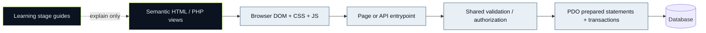

# 🔗 Browser → PHP → persistence

```mermaid
sequenceDiagram
    actor Student
    participant Browser
    participant Index as public/index.php
    participant API as public/api.php + app/api.php
    participant Actions as app/actions.php
    participant Model as app/models.php
    participant DB as PDO / InnoDB
    Student->>Browser: Submit approved-club application form
    alt JavaScript enhancement
        Browser->>API: POST /api/v1/clubs/id/memberships + JSON + CSRF cookie/header
        API->>API: Route/method, JSON, Origin, session, CSRF
        API->>Actions: perform_action join
    else Native fallback
        Browser->>Index: POST action=join, id, csrf
        Index->>Actions: handle_action → check_csrf → perform_action
    end
    Actions->>Actions: require_user and validated id
    Actions->>Model: reserve(memberships, club id, user id)
    Model->>DB: BEGIN; SELECT club FOR UPDATE
    Model->>DB: Check membership; INSERT pending + audit
    Model->>DB: COMMIT
    alt REST
        API-->>Browser: 201 JSON with data/meta
    else Native
        Index-->>Browser: flash + 303 redirect
    end
    Browser-->>Student: Updated state (still pending)
```

Opening a community later rechecks approved membership; joining alone does not grant access. Read [Student journeys](../../Stage-02-Student-Experience/04-guided-walkthroughs.md) and [backend source](../../Stage-04-Backend-Database-Security/files/app__actions_php.md) to confirm exact function signatures and UI redirects.



Text labels carry meaning independently of color. Stages do not feed executable PHP into production.
