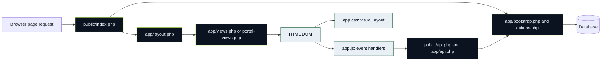

# 01 · One runtime, three browser layers

The frontend is a projection of server state. The navigation may hide an unavailable action, but only PHP can authorize it. A successful design supports both the HTML response and a REST-enhanced submission without duplicating business rules.

The diagram shows logical calls/dependencies, not that CSS executes SQL. Layout requires UI helpers; views can delegate portal routes. The canonical controller is [public/index.php](../public/index.php). [Stage 04](../Stage-04-Backend-Database-Security/README.md) explains errors, session/roles and CSRF. [Stage 02](../Stage-02-Student-Experience/README.md) explains student journeys; [Stage 03](../Stage-03-Admin-Operations/README.md) explains administration.

## Shell before content

The shell selects role-specific link groups from `$current['role']`. Public users get a public nav; authenticated users get a sidebar. `.portal .app-frame` makes room for the fixed sidebar. The theme button appears immediately before the profile details widget. A profile dropdown contains account security and sign out. A GET header form searches clubs; it is not a universal search service.

The first script, `theme-init.js`, is deliberately synchronous and sets the stored theme before CSS paints. `app.js` is deferred: it runs after parsing so selectors find forms and navigation. Neither script holds authentication in localStorage.

## Presentation contract

| Producer | Contract consumed by frontend |
|---|---|
| `layout.php` | `#navigation`, `.menu-toggle`, `.sidebar-scrim`, `.profile-menu`, `.theme-toggle`, `#main` |
| `views.php` and portal views | Native POST forms with action, CSRF and domain fields; content classes |
| `app.css` | Theme tokens, 800 px drawer rules, focus/hidden/print semantics |
| `app.js` | ARIA expansion, classes, JSON requests, recoverable error messages |
| PHP API | JSON `data` and `meta`, current CSRF token, optional internal redirect |

A selector rename is a cross-file interface change. For example, renaming `#navigation` in PHP without updating JS means the menu state may toggle without opening or focusing the actual drawer. Renaming a form field may silently route to an undefined or wrong URL.

## Status

VERIFIED BY INSPECTION at baseline `f81eab5`. This documentation adds no frontend runtime change. Runtime test outcomes must be taken from the current [validation handoff](../Assemble/10-ci-tests-and-quality-gates.md), not inferred from this diagram.
