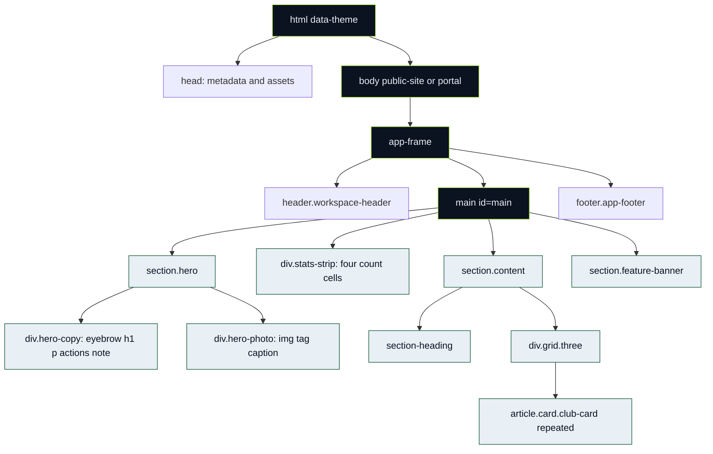

# Homepage anatomy · PHP → DOM → CSS

🔍 The actual homepage is [app/views.php](../../app/views.php), `elseif ($page==='home')`. The document shell lives in [app/layout.php](../../app/layout.php). PHP runs on the server and disappears from emitted HTML.



The route can be viewed by an authenticated user too: then the same homepage content sits inside the portal shell. The tree describes element relationships, not database tables.

## Semantic tags and attributes

`html lang="en"` declares language. `head` contains metadata and resources, not the visible hero. `body` holds visible content. `header`, `nav`, `main`, `footer` communicate page landmarks. `section` groups a named topic; `article` is a self-contained club card. `h1` states the main page subject; h2/h3 organize sections/cards. `p` is prose; `span` groups inline text; `div` groups content without a special semantic promise. `a href` navigates; `button` performs an action. An img's alt supplies alternative meaning, not a styling caption.

A `class` can be shared across many elements and maps to `.class` CSS. An `id` should be unique and maps to `#id` or a fragment link such as `#main`. `data-*` is application metadata: `data-theme` is selected in CSS and updated in JS, while `data-confirm` tells JS to ask before a destructive form. `aria-*` exposes state/names to assistive tools; it does not automatically implement behavior.

Forms use `name` to choose submitted keys. The native action is the current page because no action URL is set; hidden `action` identifies the business operation. Hidden `csrf` provides the server's request token. A hidden field is editable by users and never trustworthy just because it is invisible.

## Real PHP excerpt and emitted structure

Exact excerpt from the homepage loop:

```php
<?php foreach (rows('SELECT * FROM clubs ORDER BY id LIMIT 3') as $c):?>
```

`rows(...)` returns database rows; `foreach` binds each row to `$c`. The colon is PHP's alternate template syntax, paired with `endforeach`. Within the emitted article, `<?=e($c['name'])?>` means echo an escaped value. A synthetic name `Track & Field` therefore becomes safe HTML text represented as `Track &amp; Field` in the response; the browser displays an ampersand.

**Illustrative emitted HTML**, reduced to the relevant structure (not another source file):

```html
<div class="grid three">
  <article class="card club-card">
    <div class="sport-mark">AT</div>
    <span class="eyebrow">Athletics</span>
    <h3>Track &amp; Field</h3>
    <p>Synthetic example description.</p>
  </article>
</div>
```

`.grid.three` gives equal columns; `.card` supplies the box. There is no click listener for this article; its real nested anchor navigates to clubs. Distinguish server data from static marketing copy. `$stats` comes from SELECT COUNT subqueries, `$next` from a future-match SELECT, while the headline is literal text. The conditional `if (!$stats['clubs'])` renders an empty message if no clubs exist; do not fabricate cards/counts to fill a screenshot.

## Real selector-to-element map

| Actual element | Exact selector | Visible result |
|---|---|---|
| hero section | `.hero` | Two-column grid desktop; stacked mobile |
| copy wrapper | `.hero-copy` | Breathing room around headline |
| main headline | `.hero h1` | Large clamped type; later breakpoint overrides |
| colored headline span | `.hero h1 span` | Theme link color |
| action row | `.hero-actions` | Wrapping Flex row of links |
| photo wrapper | `.hero-photo` | Relative clipped container with minimum height |
| track image | `.hero-photo img` | Absolute cover crop and dark filter |
| overlaid caption | `.photo-caption` | Absolute bottom-left readable text |
| counter strip | `.stats-strip` | Four grid cells desktop; two below 500 |
| club container | `.grid.three` | Three equal card tracks, then responsive columns |
| club article | `.card` and `.club-card` descendants | Token surface, border, padding, sport spacing |
| fixture banner | `.feature-banner` | Flex layout, stacked below 800 |

## Try it and explain

Disable `.hero {display:grid}` temporarily in DevTools. Predict normal block stacking before observing it. Reenable, then change grid columns to `1fr`; distinguish property edits from an actual CSS-file patch. Reload restores these temporary changes. Save a labeled diagram and computed-style observation, not an authorship claim.
