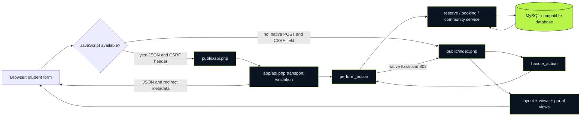
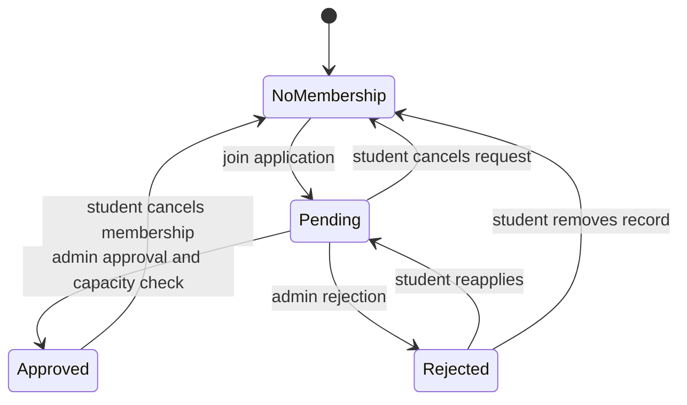

# 01 · One student interface, two transports

The app renders HTML on the server. `public/index.php` chooses `$page`, handles native form POST, checks roles and requires `app/layout.php`. The layout includes `app/views.php`; that file delegates dashboard/club/admin-portal branches to `app/portal-views.php`. PHP fragments become ordinary HTML before the browser sees them.

[Canonical view tour](files/app__views_php.md) · [Portal tour](files/app__portal-views_php.md) · [Community service](files/app__community_php.md)

## Membership is a relationship, not an account attribute

One student can join many clubs; one club can have many students. `memberships` joins those two entities and stores the decision. The unique user/club pair prevents duplicate requests from creating several memberships. A rejected request can become pending again through the existing `reserve()` upsert. Approved count, rather than all applications, controls club capacity.

The site shows a friendly gate for a nonmember requesting a private club tab. The API returns a refusal. Those are two presentation choices around the same domain restriction; a visible navigation link is not permission.

## What is shared, and who reviews it?

| Layer | Student concern | Technical owner/reviewer |
|---|---|---|
| Form and page branches | Correct fields, labels, lifecycle explanation | Stage 02 with Stage 01 presentation review |
| Student service rules | Enrollment eligibility and ownership | Stage 04, Stage 02 behavior review |
| Approval/moderation | Student-visible consequences | Stage 03, Stage 02 impact review |
| Sessions, CSRF, TOTP | Never bypass or expose secrets | Stage 04 |
| SQL and migration | Preserve existing relationships/data | Stage 04 with all affected stages |

Native success uses `go()` and HTTP 303: the next browser request is GET, so refreshing does not naturally resubmit the form. REST returns JSON; `app.js` reads its redirect metadata. Do not report these as the same wire response.

The HTML portal has deliberate display limits: latest five dashboard memberships/history, three upcoming sessions, ten feed posts per page, twenty recent comments per post, one hundred roster entries and fifty upcoming club events. API collections provide pagination where implemented; the dashboard is not a complete export.
