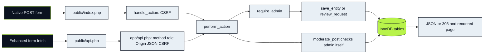

# 01 · One decision, two transports

[Start](00-start-here.md) → [Inventory](02-source-inventory.md)

The interface asks for a change; the service decides whether that change is valid; SQL records it. A role-based sidebar improves navigation but cannot enforce permissions. RBAC means **role-based access control**, checked against the authenticated user's stored role on the server.



The drawing shows *core* actions after `require_admin`. Moderation dispatch occurs earlier in `perform_action`, so `moderate_post()` contains its own guard. Shared validation is the reason both transports stay aligned; their response formats/status details still differ.

## CRUD contract

Create/Read/Update/Delete applies to clubs, tournaments, events and resources. `entities()` maps only these table names and their fields. GET management pages read records; POST native `save`/`delete` mutate them. REST create usesPOST, replacementPUT, deleteDELETE. A PUT requires the full field set used by `save_entity`; it is not a partial patch. Approval and attendance use PATCH endpoints because they change a specific state.

## Request sequence: approve a membership

```mermaid
sequenceDiagram
 actor Admin
 participant UI as Browser
 participant API as API router
 participant Action as perform_action
 participant Model as review_request
 participant DB as InnoDB
 Admin->>UI: Approve synthetic pending request
 UI->>API: PATCH /api/v1/admin/memberships/id
 API->>API: Session role, CSRF, Origin, JSON fields
 API->>Action: review with fixed entity/id
 Action->>Action: require_admin
 Action->>Model: memberships, id, approved
 Model->>DB: BEGIN and initial pending read
 Model->>DB: SELECT club FOR UPDATE
 Model->>DB: Count approved members
 Model->>DB: SELECT request FOR UPDATE; reread pending
 alt Still pending and capacity available
  Model->>DB: UPDATE status + INSERT audit + COMMIT
  API-->>UI: 200 JSON and redirect
 else Full or already reviewed
  Model->>DB: ROLLBACK
  API-->>UI: 422 domain validation error
 end
```

The parent club lock is the shared serialization point for competing memberships. Both request creation and approval use the parent protocol. The final locked request reread catches a second administrator who reviewed while this operation waited. “I checked pending once” is not enough under concurrency.

**INSPECTION RISK — not reproduced or tested in this task:** `review_request()` performs an initial nonlocking read before waiting on the parent lock. Under REPEATABLE READ, later nonlocking capacity/overlap reads may use an earlier snapshot. The final locked request reread protects the same request's pending status; parent-lock intent alone does not prove capacity safety across different requests. See [the isolation analysis and planned regression](../Stage-04-Backend-Database-Security/sql-and-transactions.md#isolation-sensitive-review-path-inspection-risk-not-reproduced).

## Tables the administrator affects

| Operation | Primary writes | Important related data |
|---|---|---|
| Save entity | clubs/tournaments/events/resources | audit; FK relationships |
| Approve/reject | memberships/bookings.status | club capacity/resource interval; audit |
| Record score | events.home_score/away_score | Results/standings derived on read |
| Mark attended | attendance.status | event start; reports derived on read |
| Moderate | club_posts.status/reason; club_reports.status | audit, member feed visibility |
| Delete parent | selected entity row | FK cascade/SET NULL; irreversible child loss |

A report is derived from these rows; there is no separate performance-report table or generated tournament bracket. Read [operational state diagrams](diagrams/admin-flows.md) and the [exact CRUD matrix](04-guided-walkthroughs.md).

## Trust boundaries and trade-offs

Hidden input IDs and browser validation can be forged. Session identity comes from the server; entity allowlists bound SQL identifiers; prepared parameters protect values; `e()` protects emitted text; CSRF links a mutation to the user's session. These controls solve different problems. An admin role is powerful, so parent deletion and private report access still need careful operational judgment.

The prototype keeps PHP view queries close to templates and shares service actions across transports. This is understandable for its scope but creates large shared files and unpaginated HTML admin lists. Archive policies, pagination improvements and stronger production administration requirements are proposals, not already implemented features.
