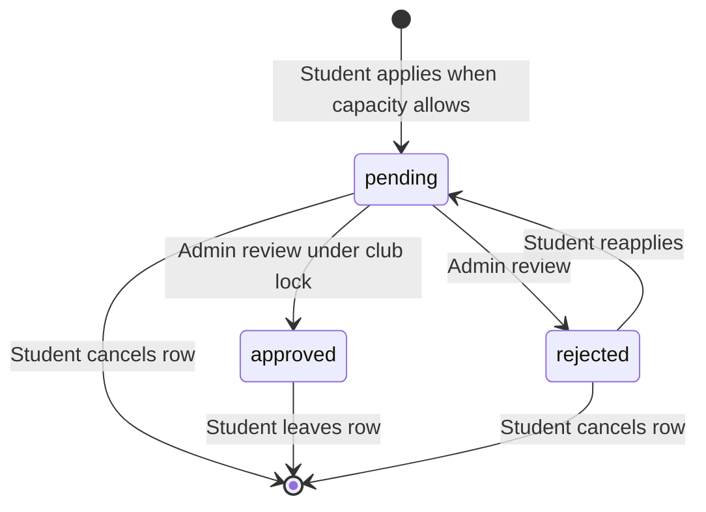
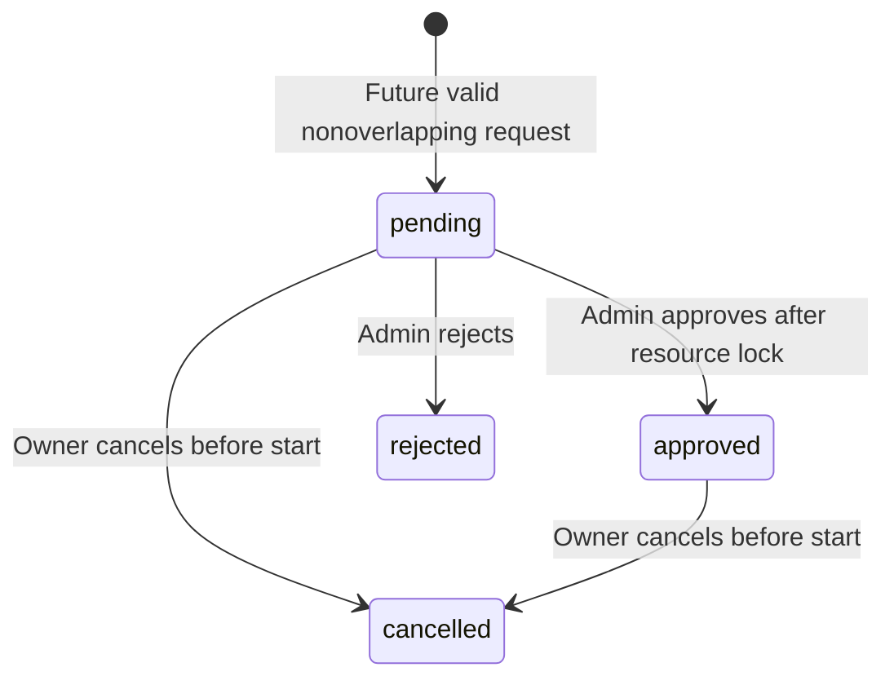
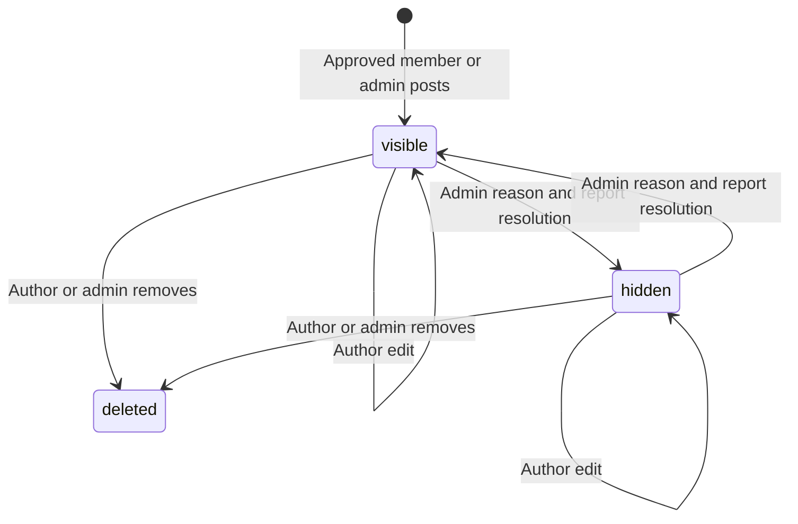
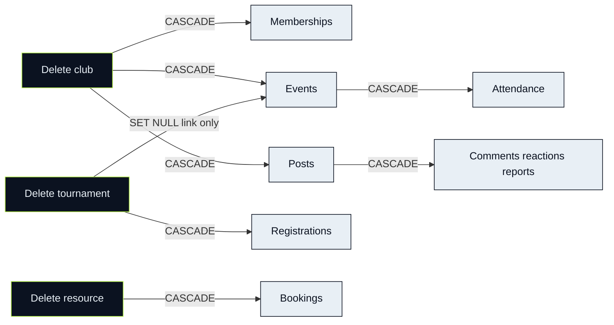

# Operational state diagrams

[Stage dashboard](../README.md) · [Request/transaction sequence](../01-architecture.md)

These diagrams describe the inspected baseline, not proposals. Node labels carry the meaning; color is decorative.

## Membership

An approved request is not reviewed again through the current pending-only review function. Joining a full club rejects rather than queues an unlimited waitlist.

## Booking

Rejected/cancelled histories remain. No completed booking enum exists; a past approved booking remains approved in storage. Pending and approved block interval creation. Touching interval endpoints do not collide.

## Community content

Deleted is terminal for content: body/reason erased, child rows removed, tombstone retained. Reports independently move pending→resolved on moderation; restoring does not reopen them.

## Parent deletion graph

The arrow from tournament to Events means clear `tournament_id`, not delete the event. Foreign keys enforce these effects even if a UI hides a delete control. Read [cascade guidance](../04-guided-walkthroughs.md#delete-impact-matrix) before any synthetic delete.
