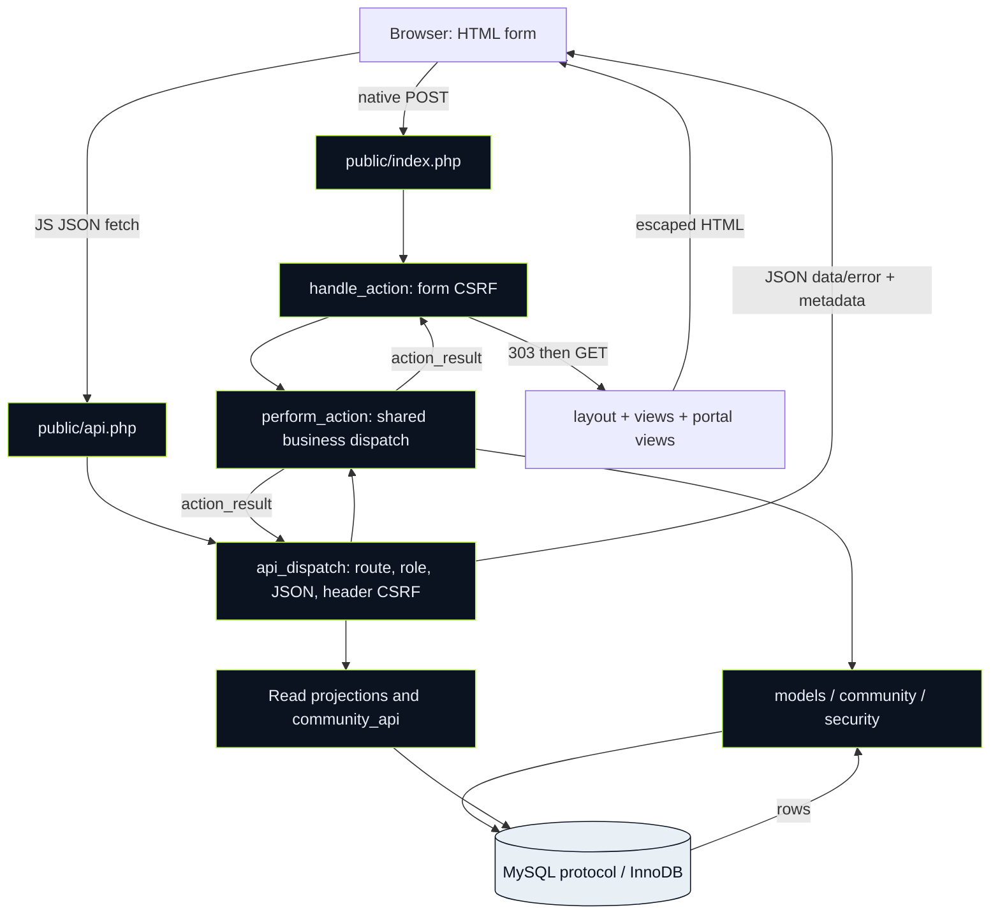

# 01 — Two transports, one set of rules

[Dashboard](README.md) · [Complete source map](02-source-inventory.md) · [Detailed sequence](diagrams/request-and-auth.md)

A transport turns HTTP into a PHP command and turns the result back into HTTP. A service enforces what the command means. A database constraint protects relationships even if PHP makes a mistake. These are complementary boundaries.

Bootstrap is loaded before the active request work: config, PDO helper definitions, sessions/headers and security primitives. `actions.php` requires models and community. Native entrypoint then requires layout, which reaches views/portal views. REST has no HTML layout and responds through `json_response`/`json_error`.

## Responsibility table

| Layer | Actual source | Owns | Does not prove |
|---|---|---|---|
| Website controller | [index](files/public__index_php.md) | Page allowlist, native POST errors, role-gated destinations | A hidden control cannot stop a forged request |
| JSON controller | [public API](files/public__api_php.md) | Request ID, safe exception mapping | A 200 without inspecting payload is not a functional test |
| REST adapter | [app API](files/app__api_php.md) | Methods/paths, body/filter allowlists, CSRF/Origin, response projection | It cannot replace service ownership/capacity checks |
| Action service | [actions](files/app__actions_php.md) | Shared mutation dispatch, login, booking, cancellation, admin gate | Not all statements here are one transaction |
| Domain model | [models](files/app__models_php.md) | CRUD validation, capacity, lock/review invariants | PHP validation alone does not prevent duplicates under races |
| SQL | [dictionary](data-dictionary.md) | Keys, unique pairs, constraints and cascade relationships | An FK does not implement role access |
| Community | [canonical guide](../Stage-02-Student-Experience/files/app__community_php.md) | Per-club approved access, ownership and moderation state | Signing in does not grant all club feed access |
| Security | [security primitives](files/app__security_php.md) | TOTP, encryption, replay/recovery, throttles, session completion | This is not independent security certification |

## Boundaries worth tracing

Browser data is untrusted even if sent by the app. The API rejects unexpected keys then injects server-owned IDs/entity values. The session supplies identity. Administrator checks happen for admin routes and shared admin actions. SQL identifiers come from metadata/regex allowlists; SQL **values** go through placeholders. Finally views call `e()` when placing untrusted text in HTML.

Dates entered as `datetime-local` have no timezone suffix. PHP interprets them in Asia/Colombo; every PDO connection sets SQL `time_zone='+05:30'`. Mixing UTC JS conversions into these forms without a reviewed conversion contract can shift booking slots by 5½ hours.

## Existing implementation limits

File sessions fit a single durable instance. Scaling to multiple nodes requires supported shared sessions. TOTP is optional, no password-reset/email verification is implemented, reports/standings use the current generic model, and local DB evidence uses MariaDB. [Security limits](../docs/security.md) and [deployment decisions](../Assemble/06-php-mysql-deployment-options.md) remain explicit.
