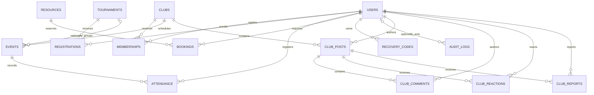

# 🧠 Complete relational data dictionary

[Stage dashboard](README.md) · [Schema source guide](files/database__schema_sql.md) · [Community migration guide](files/database__migrations__20261017_club_communities_sql.md) · [SQL clinic](sql-and-transactions.md)

**VERIFIED BY INSPECTION**, baseline `f81eab54ebe7179e1763f364d6b8d4f564c36541`: 12 core tables  + 4 additive community tables  + 1 migration ledger = **17 tables**. This dictionary describes DDL, not a live database export or a claim that a deployment has these tables. Generated field definitions below were extracted from the actual SQL blocks, including the runner-defined ledger.

> [!IMPORTANT]
> The assignment mandates **MySQL**. Current local Compose uses MariaDB 11.8. Compatibility is not proof of lecturer acceptance or identical engine behavior. Target and test MySQL 8 for production/submission, or obtain explicit approval for MariaDB. Preserve the working local database.

## How to read a field

`BIGINT UNSIGNED` is a nonnegative integer identifier; `VARCHAR(n)` is bounded variable-length text; `TEXT` stores longer text; `ENUM` restricts allowed strings. A **primary key** uniquely identifies a row. A **foreign key** requires the referenced parent row. A composite key combines columns. `NULL` means absent/unknown, which differs from an empty string or numeric zero.

The **exact declaration** is authoritative. “Permitted by declaration” means no `NOT NULL` or primary-key rule prohibits NULL; database version/SQL mode can normalize metadata. Confirm actual deployed nullability/defaults with `SHOW CREATE TABLE` or `information_schema.columns` privately, without exporting identities. A missing explicit default on a required column generally means the application must supply it under strict SQL mode. A default does not validate a business workflow.

Indexes on primary/unique keys are explicit; InnoDB may create supporting indexes for foreign keys when none already supports them. Do not claim there are no other physical indexes without inspecting engine metadata. Connection charset is utf8mb4 and local setup creates utf8mb4_unicode_ci database collation; the DDL itself does not specify each table collation. PHP and each PDO connection use Asia/Colombo / `+05:30`; local DATETIME values carry no offset. TIMESTAMP storage/conversion and session timezone must agree.

## Relationship map



`LOGIN_ATTEMPTS` and `SCHEMA_MIGRATIONS` have no foreign keys. A user can have zero memberships; each membership requires exactly one existing user and club. The circles on tournament→event and user→audit denote an optional parent FK, not optional authorization.

## Table index

- [users](#users)
- [recovery_codes](#recovery-codes)
- [login_attempts](#login-attempts)
- [clubs](#clubs)
- [memberships](#memberships)
- [tournaments](#tournaments)
- [registrations](#registrations)
- [events](#events)
- [attendance](#attendance)
- [resources](#resources)
- [bookings](#bookings)
- [audit_logs](#audit-logs)
- [club_posts](#club-posts)
- [club_comments](#club-comments)
- [club_reactions](#club-reactions)
- [club_reports](#club-reports)
- [schema_migrations](#schema-migrations)

## users

**SQL name:** `users` · **Owner/review:** Stage 04 · **Source:** [database/schema.sql](../database/schema.sql).

**Affected screens:** Register, login, profile/security; student/admin directories.

**Actual lifecycle / CRUD:** Registration inserts a student; CLI provisions admin; login may rehash/update replay counter; deletion is not exposed as routine UI CRUD.

One person per unique email; optional student_id is unique when present. Password hashes and encrypted authenticator data are deliberately omitted from projected examples.

| Column | Type | NULL allowed? | Default / generation | Inline key rules |
|---|---|---|---|---|
| `id` | `BIGINT UNSIGNED` | No | `Generated AUTO_INCREMENT` | PRIMARY KEY, AUTO_INCREMENT |
| `name` | `VARCHAR(100)` | No | `No explicit default` | See table constraints below |
| `email` | `VARCHAR(190)` | No | `No explicit default` | UNIQUE |
| `student_id` | `VARCHAR(30)` | Permitted by declaration | `No explicit default` | UNIQUE |
| `faculty` | `VARCHAR(80)` | No | `''` | See table constraints below |
| `password_hash` | `VARCHAR(255)` | No | `No explicit default` | See table constraints below |
| `role` | `ENUM('student','admin')` | No | `'student'` | See table constraints below |
| `totp_secret` | `TEXT` | Permitted by declaration | `No explicit default` | See table constraints below |
| `totp_last_counter` | `BIGINT` | Permitted by declaration | `No explicit default` | See table constraints below |
| `created_at` | `TIMESTAMP` | Permitted by declaration | `CURRENT_TIMESTAMP` | See table constraints below |

**Exact column declarations and constraints:**

```sql
CREATE TABLE IF NOT EXISTS users (
 id BIGINT UNSIGNED AUTO_INCREMENT PRIMARY KEY,
 name VARCHAR(100) NOT NULL, email VARCHAR(190) NOT NULL UNIQUE,
 student_id VARCHAR(30) NULL UNIQUE, faculty VARCHAR(80) NOT NULL DEFAULT '',
 password_hash VARCHAR(255) NOT NULL, role ENUM('student','admin') NOT NULL DEFAULT 'student',
 totp_secret TEXT NULL, totp_last_counter BIGINT NULL, created_at TIMESTAMP DEFAULT CURRENT_TIMESTAMP
) ENGINE=InnoDB;
```

**Table-level keys, indexes and relationships:**

No separate table-level constraints; inspect inline primary/unique declarations above.

**Synthetic projected row fragment (illustrative only, not a fixture import or database observation):**

```json
{
  "id": 101,
  "name": "Study Athlete",
  "email": "learner@example.invalid",
  "student_id": "LAB-101",
  "faculty": "Computing",
  "role": "student",
  "totp_secret": null
}
```

**Predict:** identify the parent row required before inserting this fragment, and which screen would reflect its next permitted state. Expand omitted required fields only in a designated disposable study database; never invent private authentication material.

## recovery codes

**SQL name:** `recovery_codes` · **Owner/review:** Stage 04 · **Source:** [database/schema.sql](../database/schema.sql).

**Affected screens:** Account security; second-factor login.

**Actual lifecycle / CRUD:** Enrollment inserts8hashes, successful recovery consumes one, disable removes all.

A row represents a single-use secret hash. Never use SELECT * in screenshots; hashes are sensitive even though not plaintext.

| Column | Type | NULL allowed? | Default / generation | Inline key rules |
|---|---|---|---|---|
| `id` | `BIGINT UNSIGNED` | No | `Generated AUTO_INCREMENT` | PRIMARY KEY, AUTO_INCREMENT |
| `user_id` | `BIGINT UNSIGNED` | No | `No explicit default` | See table constraints below |
| `code_hash` | `VARCHAR(255)` | No | `No explicit default` | See table constraints below |

**Exact column declarations and constraints:**

```sql
CREATE TABLE IF NOT EXISTS recovery_codes (
 id BIGINT UNSIGNED AUTO_INCREMENT PRIMARY KEY, user_id BIGINT UNSIGNED NOT NULL,
 code_hash VARCHAR(255) NOT NULL, FOREIGN KEY(user_id) REFERENCES users(id) ON DELETE CASCADE
) ENGINE=InnoDB;
```

**Table-level keys, indexes and relationships:**

- `FOREIGN KEY(user_id) REFERENCES users(id) ON DELETE CASCADE`

**Synthetic projected row fragment (illustrative only, not a fixture import or database observation):**

```json
{
  "id": 501,
  "user_id": 101
}
```

**Predict:** identify the parent row required before inserting this fragment, and which screen would reflect its next permitted state. Expand omitted required fields only in a designated disposable study database; never invent private authentication material.

## login attempts

**SQL name:** `login_attempts` · **Owner/review:** Stage 04 · **Source:** [database/schema.sql](../database/schema.sql).

**Affected screens:** Registration/login/2FA failures and community throttling.

**Actual lifecycle / CRUD:** throttle counts recent bucket/time entries, inserts an attempt; successful login clears its bucket.

Bucket is SHA256-derived scope/identity/IP, not a username column. Hashing is not a substitute for retention/access control.

| Column | Type | NULL allowed? | Default / generation | Inline key rules |
|---|---|---|---|---|
| `id` | `BIGINT UNSIGNED` | No | `Generated AUTO_INCREMENT` | PRIMARY KEY, AUTO_INCREMENT |
| `bucket` | `CHAR(64)` | No | `No explicit default` | See table constraints below |
| `created_at` | `TIMESTAMP` | Permitted by declaration | `CURRENT_TIMESTAMP` | See table constraints below |

**Exact column declarations and constraints:**

```sql
CREATE TABLE IF NOT EXISTS login_attempts (
 id BIGINT UNSIGNED AUTO_INCREMENT PRIMARY KEY, bucket CHAR(64) NOT NULL, created_at TIMESTAMP DEFAULT CURRENT_TIMESTAMP,
 INDEX(bucket,created_at)
) ENGINE=InnoDB;
```

**Table-level keys, indexes and relationships:**

- `INDEX(bucket,created_at)`

**Synthetic projected row fragment (illustrative only, not a fixture import or database observation):**

```json
{
  "id": 601,
  "created_at": "2026-12-01 16:00:00"
}
```

**Predict:** identify the parent row required before inserting this fragment, and which screen would reflect its next permitted state. Expand omitted required fields only in a designated disposable study database; never invent private authentication material.

## clubs

**SQL name:** `clubs` · **Owner/review:** Stage 03 primary domain; Stage 04 schema · **Source:** [database/schema.sql](../database/schema.sql).

**Affected screens:** Clubs search; student My clubs; admin Clubs.

**Actual lifecycle / CRUD:** Admin create/read/update/delete. Capacity governs approved memberships, not stored marketing statistics.

Deleting a club cascades memberships, events and posts; the resulting event/post child cascades reach participation and community children.

| Column | Type | NULL allowed? | Default / generation | Inline key rules |
|---|---|---|---|---|
| `id` | `BIGINT UNSIGNED` | No | `Generated AUTO_INCREMENT` | PRIMARY KEY, AUTO_INCREMENT |
| `name` | `VARCHAR(120)` | No | `No explicit default` | See table constraints below |
| `sport` | `VARCHAR(60)` | No | `No explicit default` | See table constraints below |
| `description` | `TEXT` | No | `No explicit default` | See table constraints below |
| `coach` | `VARCHAR(100)` | No | `No explicit default` | See table constraints below |
| `location` | `VARCHAR(120)` | No | `No explicit default` | See table constraints below |
| `capacity` | `INT UNSIGNED` | No | `50` | See table constraints below |
| `created_at` | `TIMESTAMP` | Permitted by declaration | `CURRENT_TIMESTAMP` | See table constraints below |

**Exact column declarations and constraints:**

```sql
CREATE TABLE IF NOT EXISTS clubs (
 id BIGINT UNSIGNED AUTO_INCREMENT PRIMARY KEY, name VARCHAR(120) NOT NULL, sport VARCHAR(60) NOT NULL,
 description TEXT NOT NULL, coach VARCHAR(100) NOT NULL, location VARCHAR(120) NOT NULL,
 capacity INT UNSIGNED NOT NULL DEFAULT 50, created_at TIMESTAMP DEFAULT CURRENT_TIMESTAMP
) ENGINE=InnoDB;
```

**Table-level keys, indexes and relationships:**

No separate table-level constraints; inspect inline primary/unique declarations above.

**Synthetic projected row fragment (illustrative only, not a fixture import or database observation):**

```json
{
  "id": 201,
  "name": "Study Tennis",
  "sport": "Tennis",
  "capacity": 20
}
```

**Predict:** identify the parent row required before inserting this fragment, and which screen would reflect its next permitted state. Expand omitted required fields only in a designated disposable study database; never invent private authentication material.

## memberships

**SQL name:** `memberships` · **Owner/review:** Stage 02 lifecycle; Stage 03 approval; Stage 04 schema · **Source:** [database/schema.sql](../database/schema.sql).

**Affected screens:** Club application, Approvals, My clubs, community gate.

**Actual lifecycle / CRUD:** reserve inserts/upserts rejected request to pending; review sets approved/rejected; leaving deletes own row.

Unique user/club pair models many-to-many membership. Pending and rejected do not grant community access.

| Column | Type | NULL allowed? | Default / generation | Inline key rules |
|---|---|---|---|---|
| `id` | `BIGINT UNSIGNED` | No | `Generated AUTO_INCREMENT` | PRIMARY KEY, AUTO_INCREMENT |
| `user_id` | `BIGINT UNSIGNED` | No | `No explicit default` | See table constraints below |
| `club_id` | `BIGINT UNSIGNED` | No | `No explicit default` | See table constraints below |
| `status` | `ENUM('pending','approved','rejected')` | No | `'pending'` | See table constraints below |
| `created_at` | `TIMESTAMP` | Permitted by declaration | `CURRENT_TIMESTAMP` | See table constraints below |

**Exact column declarations and constraints:**

```sql
CREATE TABLE IF NOT EXISTS memberships (
 id BIGINT UNSIGNED AUTO_INCREMENT PRIMARY KEY, user_id BIGINT UNSIGNED NOT NULL, club_id BIGINT UNSIGNED NOT NULL,
 status ENUM('pending','approved','rejected') NOT NULL DEFAULT 'pending', created_at TIMESTAMP DEFAULT CURRENT_TIMESTAMP,
 UNIQUE(user_id,club_id), FOREIGN KEY(user_id) REFERENCES users(id) ON DELETE CASCADE,
 FOREIGN KEY(club_id) REFERENCES clubs(id) ON DELETE CASCADE
) ENGINE=InnoDB;
```

**Table-level keys, indexes and relationships:**

- `UNIQUE(user_id,club_id)`
- `FOREIGN KEY(user_id) REFERENCES users(id) ON DELETE CASCADE`
- `FOREIGN KEY(club_id) REFERENCES clubs(id) ON DELETE CASCADE`

**Synthetic projected row fragment (illustrative only, not a fixture import or database observation):**

```json
{
  "id": 301,
  "user_id": 101,
  "club_id": 201,
  "status": "pending"
}
```

**Predict:** identify the parent row required before inserting this fragment, and which screen would reflect its next permitted state. Expand omitted required fields only in a designated disposable study database; never invent private authentication material.

## tournaments

**SQL name:** `tournaments` · **Owner/review:** Stage 03 domain; Stage 04 schema · **Source:** [database/schema.sql](../database/schema.sql).

**Affected screens:** Tournaments, admin tournaments, registrations/results filters.

**Actual lifecycle / CRUD:** Admin CRUD; deadline/status/capacity govern individual enrollments.

Deleting a tournament deletes registration rows but sets events.tournament_id NULL, preserving fixtures.

| Column | Type | NULL allowed? | Default / generation | Inline key rules |
|---|---|---|---|---|
| `id` | `BIGINT UNSIGNED` | No | `Generated AUTO_INCREMENT` | PRIMARY KEY, AUTO_INCREMENT |
| `name` | `VARCHAR(140)` | No | `No explicit default` | See table constraints below |
| `sport` | `VARCHAR(60)` | No | `No explicit default` | See table constraints below |
| `description` | `TEXT` | No | `No explicit default` | See table constraints below |
| `location` | `VARCHAR(120)` | No | `No explicit default` | See table constraints below |
| `starts_at` | `DATETIME` | No | `No explicit default` | See table constraints below |
| `ends_at` | `DATETIME` | No | `No explicit default` | See table constraints below |
| `registration_deadline` | `DATETIME` | No | `No explicit default` | See table constraints below |
| `capacity` | `INT UNSIGNED` | No | `32` | See table constraints below |
| `status` | `ENUM('open','ongoing','completed')` | No | `'open'` | See table constraints below |

**Exact column declarations and constraints:**

```sql
CREATE TABLE IF NOT EXISTS tournaments (
 id BIGINT UNSIGNED AUTO_INCREMENT PRIMARY KEY, name VARCHAR(140) NOT NULL, sport VARCHAR(60) NOT NULL,
 description TEXT NOT NULL, location VARCHAR(120) NOT NULL, starts_at DATETIME NOT NULL,
 ends_at DATETIME NOT NULL, registration_deadline DATETIME NOT NULL,
 capacity INT UNSIGNED NOT NULL DEFAULT 32, status ENUM('open','ongoing','completed') NOT NULL DEFAULT 'open'
) ENGINE=InnoDB;
```

**Table-level keys, indexes and relationships:**

No separate table-level constraints; inspect inline primary/unique declarations above.

**Synthetic projected row fragment (illustrative only, not a fixture import or database observation):**

```json
{
  "id": 401,
  "name": "Study Cup",
  "sport": "Tennis",
  "status": "open",
  "capacity": 16
}
```

**Predict:** identify the parent row required before inserting this fragment, and which screen would reflect its next permitted state. Expand omitted required fields only in a designated disposable study database; never invent private authentication material.

## registrations

**SQL name:** `registrations` · **Owner/review:** Stage 02 registration; Stage 04 schema · **Source:** [database/schema.sql](../database/schema.sql).

**Affected screens:** Tournament register; own history.

**Actual lifecycle / CRUD:** Insert unique user/tournament pair; own cancellation before start deletes row.

This table is an individual tournament roster. It is separate from event attendance and does not automatically register each fixture.

| Column | Type | NULL allowed? | Default / generation | Inline key rules |
|---|---|---|---|---|
| `id` | `BIGINT UNSIGNED` | No | `Generated AUTO_INCREMENT` | PRIMARY KEY, AUTO_INCREMENT |
| `user_id` | `BIGINT UNSIGNED` | No | `No explicit default` | See table constraints below |
| `tournament_id` | `BIGINT UNSIGNED` | No | `No explicit default` | See table constraints below |
| `created_at` | `TIMESTAMP` | Permitted by declaration | `CURRENT_TIMESTAMP` | See table constraints below |

**Exact column declarations and constraints:**

```sql
CREATE TABLE IF NOT EXISTS registrations (
 id BIGINT UNSIGNED AUTO_INCREMENT PRIMARY KEY, user_id BIGINT UNSIGNED NOT NULL, tournament_id BIGINT UNSIGNED NOT NULL,
 created_at TIMESTAMP DEFAULT CURRENT_TIMESTAMP, UNIQUE(user_id,tournament_id),
 FOREIGN KEY(user_id) REFERENCES users(id) ON DELETE CASCADE,
 FOREIGN KEY(tournament_id) REFERENCES tournaments(id) ON DELETE CASCADE
) ENGINE=InnoDB;
```

**Table-level keys, indexes and relationships:**

- `UNIQUE(user_id,tournament_id)`
- `FOREIGN KEY(user_id) REFERENCES users(id) ON DELETE CASCADE`
- `FOREIGN KEY(tournament_id) REFERENCES tournaments(id) ON DELETE CASCADE`

**Synthetic projected row fragment (illustrative only, not a fixture import or database observation):**

```json
{
  "id": 701,
  "user_id": 101,
  "tournament_id": 401
}
```

**Predict:** identify the parent row required before inserting this fragment, and which screen would reflect its next permitted state. Expand omitted required fields only in a designated disposable study database; never invent private authentication material.

## events

**SQL name:** `events` · **Owner/review:** Stage 03 fixtures; Stage 02 attendance; Stage 04 schema · **Source:** [database/schema.sql](../database/schema.sql).

**Affected screens:** Schedule, Results, club Schedule, admin Training & fixtures.

**Actual lifecycle / CRUD:** Admin CRUD and paired scores; event registration writes attendance rather than modifying event.

A single campus club faces a text opponent. This is not a normalized two-team league/bracket model. Score pairing and match/opponent rules are service validation, not SQL CHECK constraints.

| Column | Type | NULL allowed? | Default / generation | Inline key rules |
|---|---|---|---|---|
| `id` | `BIGINT UNSIGNED` | No | `Generated AUTO_INCREMENT` | PRIMARY KEY, AUTO_INCREMENT |
| `club_id` | `BIGINT UNSIGNED` | No | `No explicit default` | See table constraints below |
| `tournament_id` | `BIGINT UNSIGNED` | Permitted by declaration | `No explicit default` | See table constraints below |
| `title` | `VARCHAR(140)` | No | `No explicit default` | See table constraints below |
| `kind` | `ENUM('training','match')` | No | `No explicit default` | See table constraints below |
| `location` | `VARCHAR(120)` | No | `No explicit default` | See table constraints below |
| `starts_at` | `DATETIME` | No | `No explicit default` | See table constraints below |
| `ends_at` | `DATETIME` | No | `No explicit default` | See table constraints below |
| `opponent` | `VARCHAR(120)` | No | `''` | See table constraints below |
| `home_score` | `INT UNSIGNED` | Permitted by declaration | `No explicit default` | See table constraints below |
| `away_score` | `INT UNSIGNED` | Permitted by declaration | `No explicit default` | See table constraints below |

**Exact column declarations and constraints:**

```sql
CREATE TABLE IF NOT EXISTS events (
 id BIGINT UNSIGNED AUTO_INCREMENT PRIMARY KEY, club_id BIGINT UNSIGNED NOT NULL, tournament_id BIGINT UNSIGNED NULL,
 title VARCHAR(140) NOT NULL, kind ENUM('training','match') NOT NULL, location VARCHAR(120) NOT NULL,
 starts_at DATETIME NOT NULL, ends_at DATETIME NOT NULL, opponent VARCHAR(120) NOT NULL DEFAULT '',
 home_score INT UNSIGNED NULL, away_score INT UNSIGNED NULL,
 FOREIGN KEY(club_id) REFERENCES clubs(id) ON DELETE CASCADE,
 FOREIGN KEY(tournament_id) REFERENCES tournaments(id) ON DELETE SET NULL
) ENGINE=InnoDB;
```

**Table-level keys, indexes and relationships:**

- `FOREIGN KEY(club_id) REFERENCES clubs(id) ON DELETE CASCADE`
- `FOREIGN KEY(tournament_id) REFERENCES tournaments(id) ON DELETE SET NULL`

**Synthetic projected row fragment (illustrative only, not a fixture import or database observation):**

```json
{
  "id": 801,
  "club_id": 201,
  "tournament_id": 401,
  "kind": "match",
  "title": "Study Friendly",
  "home_score": 2,
  "away_score": 1
}
```

**Predict:** identify the parent row required before inserting this fragment, and which screen would reflect its next permitted state. Expand omitted required fields only in a designated disposable study database; never invent private authentication material.

## attendance

**SQL name:** `attendance` · **Owner/review:** Stage 02 registration; Stage 03 recorded attendance; Stage 04 schema · **Source:** [database/schema.sql](../database/schema.sql).

**Affected screens:** Schedule registration, Reports, participation history.

**Actual lifecycle / CRUD:** reserve inserts registered; admin marks attended after start; own future uncompleted cancellation deletes.

Registered means reserved participation; attended means recorded presence. Do not count all registrations as attendance.

| Column | Type | NULL allowed? | Default / generation | Inline key rules |
|---|---|---|---|---|
| `id` | `BIGINT UNSIGNED` | No | `Generated AUTO_INCREMENT` | PRIMARY KEY, AUTO_INCREMENT |
| `user_id` | `BIGINT UNSIGNED` | No | `No explicit default` | See table constraints below |
| `event_id` | `BIGINT UNSIGNED` | No | `No explicit default` | See table constraints below |
| `status` | `ENUM('registered','attended')` | No | `'registered'` | See table constraints below |

**Exact column declarations and constraints:**

```sql
CREATE TABLE IF NOT EXISTS attendance (
 id BIGINT UNSIGNED AUTO_INCREMENT PRIMARY KEY, user_id BIGINT UNSIGNED NOT NULL, event_id BIGINT UNSIGNED NOT NULL,
 status ENUM('registered','attended') NOT NULL DEFAULT 'registered', UNIQUE(user_id,event_id),
 FOREIGN KEY(user_id) REFERENCES users(id) ON DELETE CASCADE, FOREIGN KEY(event_id) REFERENCES events(id) ON DELETE CASCADE
) ENGINE=InnoDB;
```

**Table-level keys, indexes and relationships:**

- `UNIQUE(user_id,event_id)`
- `FOREIGN KEY(user_id) REFERENCES users(id) ON DELETE CASCADE`
- `FOREIGN KEY(event_id) REFERENCES events(id) ON DELETE CASCADE`

**Synthetic projected row fragment (illustrative only, not a fixture import or database observation):**

```json
{
  "id": 901,
  "user_id": 101,
  "event_id": 801,
  "status": "registered"
}
```

**Predict:** identify the parent row required before inserting this fragment, and which screen would reflect its next permitted state. Expand omitted required fields only in a designated disposable study database; never invent private authentication material.

## resources

**SQL name:** `resources` · **Owner/review:** Stage 03 operations; Stage 04 schema · **Source:** [database/schema.sql](../database/schema.sql).

**Affected screens:** Facilities, booking forms, admin Resources.

**Actual lifecycle / CRUD:** Admin CRUD; each record represents one reservable unit.

No inventory quantity column exists. Equipment capacity needs separate units or a reviewed future accounting design.

| Column | Type | NULL allowed? | Default / generation | Inline key rules |
|---|---|---|---|---|
| `id` | `BIGINT UNSIGNED` | No | `Generated AUTO_INCREMENT` | PRIMARY KEY, AUTO_INCREMENT |
| `name` | `VARCHAR(120)` | No | `No explicit default` | See table constraints below |
| `kind` | `ENUM('facility','equipment')` | No | `No explicit default` | See table constraints below |
| `description` | `TEXT` | No | `No explicit default` | See table constraints below |
| `location` | `VARCHAR(120)` | No | `No explicit default` | See table constraints below |

**Exact column declarations and constraints:**

```sql
CREATE TABLE IF NOT EXISTS resources (
 id BIGINT UNSIGNED AUTO_INCREMENT PRIMARY KEY, name VARCHAR(120) NOT NULL,
 kind ENUM('facility','equipment') NOT NULL, description TEXT NOT NULL, location VARCHAR(120) NOT NULL
) ENGINE=InnoDB;
```

**Table-level keys, indexes and relationships:**

No separate table-level constraints; inspect inline primary/unique declarations above.

**Synthetic projected row fragment (illustrative only, not a fixture import or database observation):**

```json
{
  "id": 1001,
  "name": "Study Court",
  "kind": "facility",
  "location": "Practice zone"
}
```

**Predict:** identify the parent row required before inserting this fragment, and which screen would reflect its next permitted state. Expand omitted required fields only in a designated disposable study database; never invent private authentication material.

## bookings

**SQL name:** `bookings` · **Owner/review:** Stage 02 request; Stage 03 review; Stage 04 schema · **Source:** [database/schema.sql](../database/schema.sql).

**Affected screens:** Facilities, Approvals, participation/activity.

**Actual lifecycle / CRUD:** Request inserts pending; review approved/rejected; own eligible cancellation preserves row as cancelled.

The index speeds candidate interval lookup; it does not prohibit overlapping times. Service transactions lock resources and test overlap.

| Column | Type | NULL allowed? | Default / generation | Inline key rules |
|---|---|---|---|---|
| `id` | `BIGINT UNSIGNED` | No | `Generated AUTO_INCREMENT` | PRIMARY KEY, AUTO_INCREMENT |
| `user_id` | `BIGINT UNSIGNED` | No | `No explicit default` | See table constraints below |
| `resource_id` | `BIGINT UNSIGNED` | No | `No explicit default` | See table constraints below |
| `starts_at` | `DATETIME` | No | `No explicit default` | See table constraints below |
| `ends_at` | `DATETIME` | No | `No explicit default` | See table constraints below |
| `purpose` | `VARCHAR(255)` | No | `No explicit default` | See table constraints below |
| `status` | `ENUM('pending','approved','rejected','cancelled')` | No | `'pending'` | See table constraints below |
| `created_at` | `TIMESTAMP` | Permitted by declaration | `CURRENT_TIMESTAMP` | See table constraints below |

**Exact column declarations and constraints:**

```sql
CREATE TABLE IF NOT EXISTS bookings (
 id BIGINT UNSIGNED AUTO_INCREMENT PRIMARY KEY, user_id BIGINT UNSIGNED NOT NULL, resource_id BIGINT UNSIGNED NOT NULL,
 starts_at DATETIME NOT NULL, ends_at DATETIME NOT NULL, purpose VARCHAR(255) NOT NULL,
 status ENUM('pending','approved','rejected','cancelled') NOT NULL DEFAULT 'pending', created_at TIMESTAMP DEFAULT CURRENT_TIMESTAMP,
 FOREIGN KEY(user_id) REFERENCES users(id) ON DELETE CASCADE, FOREIGN KEY(resource_id) REFERENCES resources(id) ON DELETE CASCADE,
 INDEX(resource_id,starts_at,ends_at)
) ENGINE=InnoDB;
```

**Table-level keys, indexes and relationships:**

- `FOREIGN KEY(user_id) REFERENCES users(id) ON DELETE CASCADE`
- `FOREIGN KEY(resource_id) REFERENCES resources(id) ON DELETE CASCADE`
- `INDEX(resource_id,starts_at,ends_at)`

**Synthetic projected row fragment (illustrative only, not a fixture import or database observation):**

```json
{
  "id": 1101,
  "user_id": 101,
  "resource_id": 1001,
  "starts_at": "2026-12-01 16:00:00",
  "ends_at": "2026-12-01 17:00:00",
  "purpose": "Synthetic lab",
  "status": "pending"
}
```

**Predict:** identify the parent row required before inserting this fragment, and which screen would reflect its next permitted state. Expand omitted required fields only in a designated disposable study database; never invent private authentication material.

## audit logs

**SQL name:** `audit_logs` · **Owner/review:** Stage 03 review; Stage 04 security · **Source:** [database/schema.sql](../database/schema.sql).

**Affected screens:** Admin Audit history; CLI/support diagnostics.

**Actual lifecycle / CRUD:** audit inserts operation label/details/actor; no routine UI edit/delete.

Nullable actor preserves history on account deletion. Details should remain bounded operational metadata, never full payloads/secrets.

| Column | Type | NULL allowed? | Default / generation | Inline key rules |
|---|---|---|---|---|
| `id` | `BIGINT UNSIGNED` | No | `Generated AUTO_INCREMENT` | PRIMARY KEY, AUTO_INCREMENT |
| `user_id` | `BIGINT UNSIGNED` | Permitted by declaration | `No explicit default` | See table constraints below |
| `action` | `VARCHAR(100)` | No | `No explicit default` | See table constraints below |
| `details` | `VARCHAR(255)` | No | `No explicit default` | See table constraints below |
| `created_at` | `TIMESTAMP` | Permitted by declaration | `CURRENT_TIMESTAMP` | See table constraints below |

**Exact column declarations and constraints:**

```sql
CREATE TABLE IF NOT EXISTS audit_logs (
 id BIGINT UNSIGNED AUTO_INCREMENT PRIMARY KEY, user_id BIGINT UNSIGNED NULL, action VARCHAR(100) NOT NULL,
 details VARCHAR(255) NOT NULL, created_at TIMESTAMP DEFAULT CURRENT_TIMESTAMP,
 FOREIGN KEY(user_id) REFERENCES users(id) ON DELETE SET NULL
) ENGINE=InnoDB;
```

**Table-level keys, indexes and relationships:**

- `FOREIGN KEY(user_id) REFERENCES users(id) ON DELETE SET NULL`

**Synthetic projected row fragment (illustrative only, not a fixture import or database observation):**

```json
{
  "id": 1201,
  "user_id": 101,
  "action": "reserve_memberships",
  "details": "Record 201"
}
```

**Predict:** identify the parent row required before inserting this fragment, and which screen would reflect its next permitted state. Expand omitted required fields only in a designated disposable study database; never invent private authentication material.

## club posts

**SQL name:** `club_posts` · **Owner/review:** Stage 02 author/content; Stage 03 moderation; Stage 04 schema · **Source:** [database/migrations/20261017_club_communities.sql](../database/migrations/20261017_club_communities.sql).

**Affected screens:** Club Community, admin moderation.

**Actual lifecycle / CRUD:** Author create/edit; hide/restore with admin reason; delete retains ID/status tombstone while erasing body/children.

The enum does not filter reads by itself. Deleted is terminal; author correction of hidden content cannot restore visibility.

| Column | Type | NULL allowed? | Default / generation | Inline key rules |
|---|---|---|---|---|
| `id` | `BIGINT UNSIGNED` | No | `Generated AUTO_INCREMENT` | PRIMARY KEY, AUTO_INCREMENT |
| `club_id` | `BIGINT UNSIGNED` | No | `No explicit default` | See table constraints below |
| `user_id` | `BIGINT UNSIGNED` | No | `No explicit default` | See table constraints below |
| `body` | `TEXT` | No | `No explicit default` | See table constraints below |
| `status` | `ENUM('visible','hidden','deleted')` | No | `'visible'` | See table constraints below |
| `moderation_reason` | `VARCHAR(500)` | No | `''` | See table constraints below |
| `created_at` | `TIMESTAMP` | Permitted by declaration | `CURRENT_TIMESTAMP` | See table constraints below |
| `updated_at` | `TIMESTAMP` | Permitted by declaration | `CURRENT_TIMESTAMP` | See table constraints below |

**Exact column declarations and constraints:**

```sql
CREATE TABLE IF NOT EXISTS club_posts (
 id BIGINT UNSIGNED AUTO_INCREMENT PRIMARY KEY,
 club_id BIGINT UNSIGNED NOT NULL, user_id BIGINT UNSIGNED NOT NULL,
 body TEXT NOT NULL, status ENUM('visible','hidden','deleted') NOT NULL DEFAULT 'visible',
 moderation_reason VARCHAR(500) NOT NULL DEFAULT '',
 created_at TIMESTAMP DEFAULT CURRENT_TIMESTAMP,
 updated_at TIMESTAMP DEFAULT CURRENT_TIMESTAMP ON UPDATE CURRENT_TIMESTAMP,
 FOREIGN KEY(club_id) REFERENCES clubs(id) ON DELETE CASCADE,
 FOREIGN KEY(user_id) REFERENCES users(id) ON DELETE CASCADE,
 INDEX(club_id,status,id)
) ENGINE=InnoDB;
```

**Table-level keys, indexes and relationships:**

- `FOREIGN KEY(club_id) REFERENCES clubs(id) ON DELETE CASCADE`
- `FOREIGN KEY(user_id) REFERENCES users(id) ON DELETE CASCADE`
- `INDEX(club_id,status,id)`

**Synthetic projected row fragment (illustrative only, not a fixture import or database observation):**

```json
{
  "id": 1301,
  "club_id": 201,
  "user_id": 101,
  "body": "Synthetic practice update",
  "status": "visible"
}
```

**Predict:** identify the parent row required before inserting this fragment, and which screen would reflect its next permitted state. Expand omitted required fields only in a designated disposable study database; never invent private authentication material.

## club comments

**SQL name:** `club_comments` · **Owner/review:** Stage 02; Stage 04 schema · **Source:** [database/migrations/20261017_club_communities.sql](../database/migrations/20261017_club_communities.sql).

**Affected screens:** Club post comments.

**Actual lifecycle / CRUD:** Approved member inserts; own author/admin deletes; parent deletion removes children.

Body is plain text, escaped at HTML output; no rich HTML/Markdown rendering contract exists.

| Column | Type | NULL allowed? | Default / generation | Inline key rules |
|---|---|---|---|---|
| `id` | `BIGINT UNSIGNED` | No | `Generated AUTO_INCREMENT` | PRIMARY KEY, AUTO_INCREMENT |
| `post_id` | `BIGINT UNSIGNED` | No | `No explicit default` | See table constraints below |
| `user_id` | `BIGINT UNSIGNED` | No | `No explicit default` | See table constraints below |
| `body` | `TEXT` | No | `No explicit default` | See table constraints below |
| `created_at` | `TIMESTAMP` | Permitted by declaration | `CURRENT_TIMESTAMP` | See table constraints below |

**Exact column declarations and constraints:**

```sql
CREATE TABLE IF NOT EXISTS club_comments (
 id BIGINT UNSIGNED AUTO_INCREMENT PRIMARY KEY, post_id BIGINT UNSIGNED NOT NULL,
 user_id BIGINT UNSIGNED NOT NULL, body TEXT NOT NULL,
 created_at TIMESTAMP DEFAULT CURRENT_TIMESTAMP,
 FOREIGN KEY(post_id) REFERENCES club_posts(id) ON DELETE CASCADE,
 FOREIGN KEY(user_id) REFERENCES users(id) ON DELETE CASCADE,
 INDEX(post_id,id)
) ENGINE=InnoDB;
```

**Table-level keys, indexes and relationships:**

- `FOREIGN KEY(post_id) REFERENCES club_posts(id) ON DELETE CASCADE`
- `FOREIGN KEY(user_id) REFERENCES users(id) ON DELETE CASCADE`
- `INDEX(post_id,id)`

**Synthetic projected row fragment (illustrative only, not a fixture import or database observation):**

```json
{
  "id": 1401,
  "post_id": 1301,
  "user_id": 101,
  "body": "Synthetic reply"
}
```

**Predict:** identify the parent row required before inserting this fragment, and which screen would reflect its next permitted state. Expand omitted required fields only in a designated disposable study database; never invent private authentication material.

## club reactions

**SQL name:** `club_reactions` · **Owner/review:** Stage 02; Stage 04 schema · **Source:** [database/migrations/20261017_club_communities.sql](../database/migrations/20261017_club_communities.sql).

**Affected screens:** Club post reaction count/button.

**Actual lifecycle / CRUD:** PUT upserts/ignores existing pair; DELETE removes own pair idempotently.

Composite primary key avoids a surrogate ID when the pair already uniquely identifies the relation.

| Column | Type | NULL allowed? | Default / generation | Inline key rules |
|---|---|---|---|---|
| `post_id` | `BIGINT UNSIGNED` | No | `No explicit default` | See table constraints below |
| `user_id` | `BIGINT UNSIGNED` | No | `No explicit default` | See table constraints below |
| `created_at` | `TIMESTAMP` | Permitted by declaration | `CURRENT_TIMESTAMP` | See table constraints below |

**Exact column declarations and constraints:**

```sql
CREATE TABLE IF NOT EXISTS club_reactions (
 post_id BIGINT UNSIGNED NOT NULL, user_id BIGINT UNSIGNED NOT NULL,
 created_at TIMESTAMP DEFAULT CURRENT_TIMESTAMP,
 PRIMARY KEY(post_id,user_id),
 FOREIGN KEY(post_id) REFERENCES club_posts(id) ON DELETE CASCADE,
 FOREIGN KEY(user_id) REFERENCES users(id) ON DELETE CASCADE
) ENGINE=InnoDB;
```

**Table-level keys, indexes and relationships:**

- `PRIMARY KEY(post_id,user_id)`
- `FOREIGN KEY(post_id) REFERENCES club_posts(id) ON DELETE CASCADE`
- `FOREIGN KEY(user_id) REFERENCES users(id) ON DELETE CASCADE`

**Synthetic projected row fragment (illustrative only, not a fixture import or database observation):**

```json
{
  "post_id": 1301,
  "user_id": 101
}
```

**Predict:** identify the parent row required before inserting this fragment, and which screen would reflect its next permitted state. Expand omitted required fields only in a designated disposable study database; never invent private authentication material.

## club reports

**SQL name:** `club_reports` · **Owner/review:** Stage 02 submit; Stage 03 private review; Stage 04 schema · **Source:** [database/migrations/20261017_club_communities.sql](../database/migrations/20261017_club_communities.sql).

**Affected screens:** Private report form; admin moderation queue/reasons.

**Actual lifecycle / CRUD:** Insert one per user/post; moderation resolves pending reports; deleted post removes reports.

Reasons and reporter details remain admin-only. Unique pair prevents repeat reports; duplicate POST returns conflict, unlike idempotent reaction PUT.

| Column | Type | NULL allowed? | Default / generation | Inline key rules |
|---|---|---|---|---|
| `id` | `BIGINT UNSIGNED` | No | `Generated AUTO_INCREMENT` | PRIMARY KEY, AUTO_INCREMENT |
| `post_id` | `BIGINT UNSIGNED` | No | `No explicit default` | See table constraints below |
| `user_id` | `BIGINT UNSIGNED` | No | `No explicit default` | See table constraints below |
| `reason` | `VARCHAR(500)` | No | `No explicit default` | See table constraints below |
| `status` | `ENUM('pending','resolved')` | No | `'pending'` | See table constraints below |
| `created_at` | `TIMESTAMP` | Permitted by declaration | `CURRENT_TIMESTAMP` | See table constraints below |

**Exact column declarations and constraints:**

```sql
CREATE TABLE IF NOT EXISTS club_reports (
 id BIGINT UNSIGNED AUTO_INCREMENT PRIMARY KEY, post_id BIGINT UNSIGNED NOT NULL,
 user_id BIGINT UNSIGNED NOT NULL, reason VARCHAR(500) NOT NULL,
 status ENUM('pending','resolved') NOT NULL DEFAULT 'pending', created_at TIMESTAMP DEFAULT CURRENT_TIMESTAMP,
 UNIQUE(post_id,user_id), INDEX(status,id),
 FOREIGN KEY(post_id) REFERENCES club_posts(id) ON DELETE CASCADE,
 FOREIGN KEY(user_id) REFERENCES users(id) ON DELETE CASCADE
) ENGINE=InnoDB;
```

**Table-level keys, indexes and relationships:**

- `UNIQUE(post_id,user_id)`
- `INDEX(status,id)`
- `FOREIGN KEY(post_id) REFERENCES club_posts(id) ON DELETE CASCADE`
- `FOREIGN KEY(user_id) REFERENCES users(id) ON DELETE CASCADE`

**Synthetic projected row fragment (illustrative only, not a fixture import or database observation):**

```json
{
  "id": 1501,
  "post_id": 1301,
  "user_id": 101,
  "reason": "Synthetic safety review",
  "status": "pending"
}
```

**Predict:** identify the parent row required before inserting this fragment, and which screen would reflect its next permitted state. Expand omitted required fields only in a designated disposable study database; never invent private authentication material.

## schema migrations

**SQL name:** `schema_migrations` · **Owner/review:** Stage 04; Assemble release review · **Source:** [bin/migrate.php](../bin/migrate.php).

**Affected screens:** No public screen; private migration history.

**Actual lifecycle / CRUD:** Migration inserts filename only after statements succeed; applied records are not manually edited for routine upgrades.

Defined in bin/migrate.php, not a SQL file; includes it to avoid missing a real database table. No FK connects migration metadata to app identities.

| Column | Type | NULL allowed? | Default / generation | Inline key rules |
|---|---|---|---|---|
| `version` | `VARCHAR(190)` | No | `No explicit default` | PRIMARY KEY |
| `applied_at` | `TIMESTAMP` | Permitted by declaration | `CURRENT_TIMESTAMP` | See table constraints below |

**Exact column declarations and constraints:**

```sql
CREATE TABLE IF NOT EXISTS schema_migrations (version VARCHAR(190) PRIMARY KEY, applied_at TIMESTAMP DEFAULT CURRENT_TIMESTAMP) ENGINE=InnoDB
```

**Table-level keys, indexes and relationships:**

No separate table-level constraints; inspect inline primary/unique declarations above.

**Synthetic projected row fragment (illustrative only, not a fixture import or database observation):**

```json
{
  "version": "20261017_club_communities.sql"
}
```

**Predict:** identify the parent row required before inserting this fragment, and which screen would reflect its next permitted state. Expand omitted required fields only in a designated disposable study database; never invent private authentication material.

## Database-level rules versus service rules

| Rule | SQL enforces | PHP/service enforces |
|---|---|---|
| Unique club membership | UNIQUE(user_id,club_id) | reapply only after rejection; capacity under parent lock |
| Approved membership required to register session | FKs require user/event to exist | reserve checks approved club membership and future session |
| Valid tournament enrollment | UNIQUE pair and FKs | open status, deadline, capacity under tournament row lock |
| Booking collision | FK and interval index | future interval ≤4h, overlap query, resource row lock |
| Paired scores only for match with opponent | Nullable unsigned score columns | save_entity verifies both-or-neither, match kind and opponent |
| One reaction/report per user/post | Composite primary / unique pair | approved club access, reaction idempotence / duplicate-report conflict |
| No hidden/deleted post in member feed | ENUM admits statuses | visibility filters and parent lock; hidden author edit preserves status |

The schema is normalized around entities and join tables, but deliberately uses a free-text match opponent and single-unit resources. These are documented product limits, not reasons to replace the baseline. There are no SQL CHECK constraints for interval duration, capacity occupancy or score pairing in this version.

## Read-only inspection lab

**Objective:** distinguish schema facts from live private rows. **Prerequisites:** a local disposable study environment with a known database identity, not production. **Setup:** select `sportshub_test` explicitly in your SQL client only after verifying it is disposable; the following commands read metadata, not identities.

```sql
SELECT DATABASE();
SHOW CREATE TABLE memberships;
SHOW INDEX FROM bookings;
SELECT table_name, column_name, column_type, is_nullable, column_default
FROM information_schema.columns
WHERE table_schema = DATABASE()
ORDER BY table_name, ordinal_position;
```

**Predict:** which indexes include two columns and which include three? **Expected:** membership unique pair, booking resource/start/end index and community feed club/status/id index. Additional FK indexes may exist. **Save:** redacted metadata, not row exports, and explain one difference between declaration and engine normalization. **Revert:** no data changed; close the client. Do not clear any schema as cleanup.

<details><summary>Answer key and viva prompts</summary>

A useful index begins with columns used for equality filtering, then order/range access where possible. An interval query has two inequalities and cannot generally exploit both as a simple exact composite lookup; use EXPLAIN on synthetic volume before proposing indexes. A foreign key validates existence, not role or ownership. Explain why removing the UNIQUE membership pair creates a race even if the UI disables the join button.

</details>

**Current execution evidence:** [Assemble register](../Assemble/16-evidence-and-artifact-register.md). No live dataset or successful MySQL 8deployment is claimed by this dictionary.
