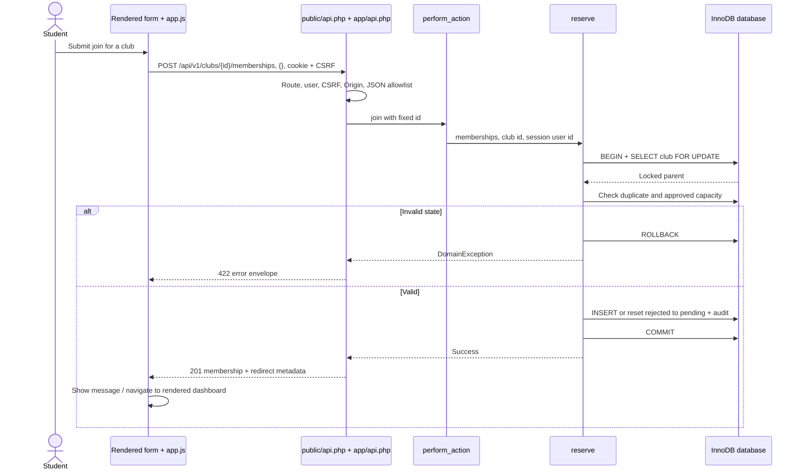
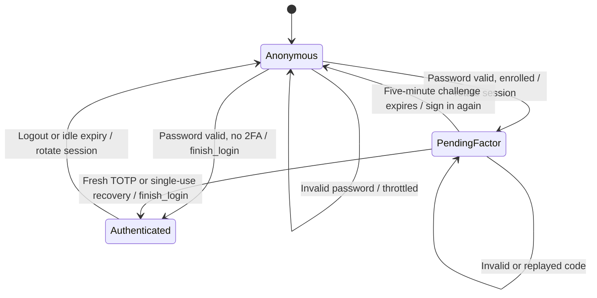

# 🔗 Request and authentication diagrams

[Architecture](../01-architecture.md) · [Walkthroughs](../04-guided-walkthroughs.md)

## Enhanced membership write

Native path differs only in transport: index→handle_action checks hidden csrf, reaches the same perform_action/reserve, then303 and server-rendered GET. Do not draw REST as the only path.

## Login state machine

Authenticated account/security settings may prepare a ten-minute setup secret, then activate enrollment only after current password+valid TOTP. Setup and pending login are distinct states. No diagram implies a bypass or an automatic recovery email service.
