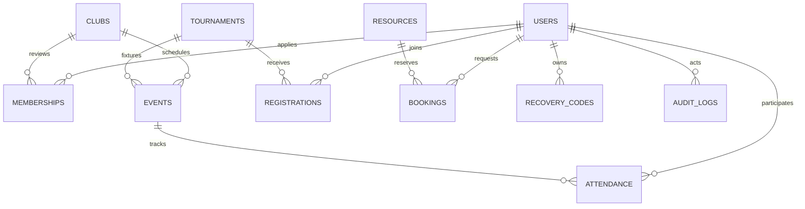

# Architecture

Server-rendered PHP, native HTML forms and progressively enhanced JavaScript keep the project within the mandated stack and suitable for common PHP hosting. JavaScript submits mutations to the JSON REST API at `/api/v1`; native forms continue to work without JavaScript. Public read pages are server-rendered, and matching JSON read endpoints support other same-origin clients. `public/index.php` validates pages, delegates POST actions, and renders shared layout/views. `public/api.php` and `app/api.php` route REST requests, enforce JSON/CSRF, paginate collections and format errors; `app/actions.php` authenticates/authorizes shared mutations; `app/models.php` validates administrative records and protects reservations in transactions. `app/security.php` owns TOTP, encryption and authentication throttles. PDO uses native prepared statements and UTF-8.

Each event is associated with one campus club and an optional tournament. Matches record an opponent name and paired nonnegative scores. A student must have an approved club membership to register for an event. Attendance is marked by an administrator after a session starts. Tournaments and sessions have separate registration records; a tournament registration does not automatically enroll a player in each fixture.

Membership, tournament registration and booking contention serialize on their parent resource rows. Unique constraints prevent duplicate participation. Review operations reread status under lock. Ownership is included directly in cancellation SQL conditions. CSRF and roles are checked even when forms are forged outside the interface.

Time displayed and entered is Sri Lanka time. Each PDO connection sets the MySQL session timezone to +05:30 so database `NOW()` checks agree with PHP date processing.

The logo and athletics photograph came from the user's supplied Home-Clubs archive; the green/navy palette and sports content are inspired by both supplied frontend archives. The PHP application and shared responsive frontend were implemented for this project. Confirm the team's rights to use supplied imagery before public hosting.

The OpenAPI contract documents 61 operations. Cookie sessions avoid exposing bearer tokens to browser scripts. GET auth/session bootstraps CSRF; password/TOTP completion rotates sessions and tokens. API errors use status codes and opaque request IDs without revealing database details. Docker uses Apache/PHP with a health-gated MariaDB dependency and persistent volumes for database/session/encryption-key state.
